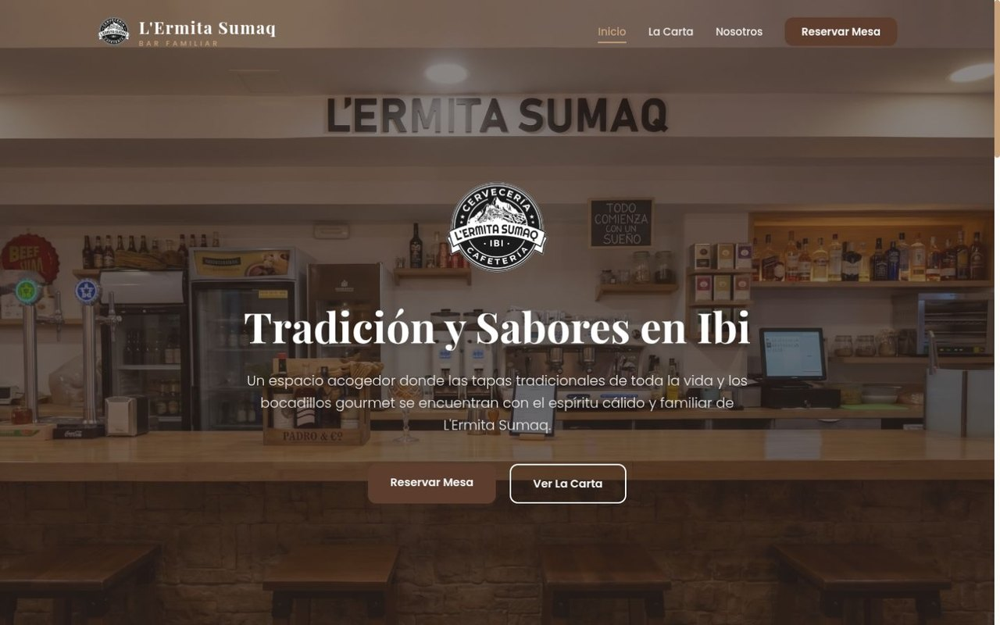
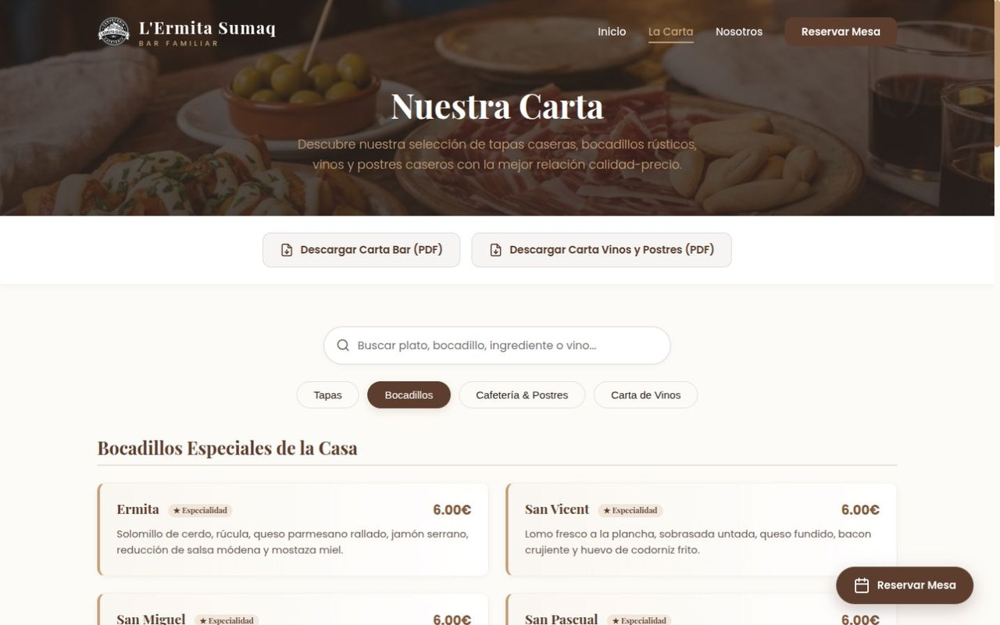
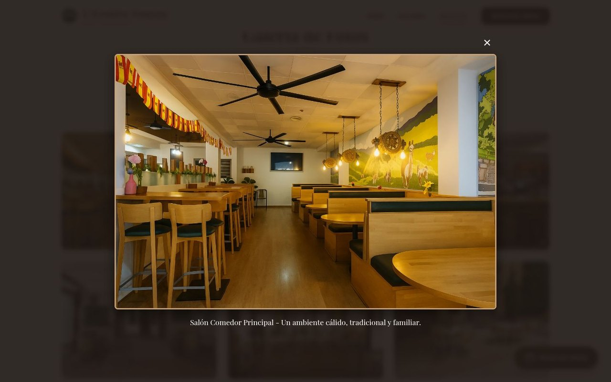
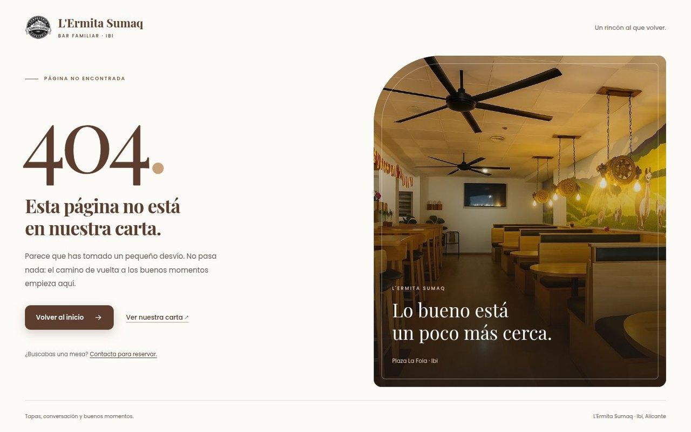

# L'Ermita Sumaq

A responsive restaurant website for a real bar and café in **Ibi, Alicante, Spain**. It brings the menu, venue photographs, opening hours and reservation contact details together in a small, framework-free website.

Built as a real-world web development project and presented in the portfolio of [P123pablo](https://github.com/P123pablo), an Artificial Intelligence Engineering student and software developer.

**Deployment status:** prepared for Cloudflare Pages. The configured canonical domain is [ermitasumaq.com](https://ermitasumaq.com/); production availability has not been verified as part of this publication preparation.

## Preview

### Desktop



### Mobile


### Interactive menu



### Photo gallery



### Custom 404



These screenshots were captured from the local application on 8 November 2026. They are stored separately from the production assets and are not included in the deployment package.

## What the website does

- Presents the restaurant, its location and contact details.
- Displays **109 menu entries** across tapas, sandwiches, coffee/desserts and wine categories.
- Filters dishes by category and searches names, descriptions and subcategories without requiring accents.
- Supports category deep links and browser Back/Forward navigation over HTTP.
- Provides a filterable photo gallery with a native modal dialog, keyboard operation and focus restoration.
- Shows the usual opening status in the **Europe/Madrid** time zone. Holidays and exceptional closures require confirmation with the restaurant.
- Links to the original PDF menus and provides direct telephone and WhatsApp contact for reservations.
- Handles missing pages with a branded, responsive 404 page.

**Reservations are handled by the restaurant through telephone or WhatsApp.** The website does not store bookings, check table availability or automatically confirm reservations. It has no backend, database, payment system or offline service worker.

## Technology

| Area | Implementation |
| --- | --- |
| Pages | Semantic HTML5 |
| Layout and styling | CSS Grid, Flexbox, custom properties and media queries |
| Interaction | Vanilla JavaScript and browser APIs |
| Fonts | Locally hosted Poppins and Playfair Display, with SIL Open Font Licenses |
| Images | WebP variants, responsive image candidates and retained source photographs |
| Local tools | Python standard library; Node.js for JavaScript checks |
| Hosting preparation | Static Cloudflare Pages output, `_headers`, `_redirects`, root `404.html` |

There are no application package dependencies or framework build steps. Pillow is only needed when regenerating image assets, not to run or deploy the site.

## Development scope

The implementation covers the restaurant's multi-page interface, responsive layouts, interactive menu, gallery, reservation contact flow, SEO metadata, local business structured data and deployment configuration. The work also includes accessibility corrections, image and font delivery improvements, the custom error page, and project documentation.

The repository demonstrates frontend development and integration of existing restaurant content. It does not claim authorship of every original photograph, logo, dish description or business document.

## Accessibility and quality

Implemented features include a skip link, a main content landmark, visible keyboard focus, labelled search and navigation controls, announced search results, mobile menu state, native gallery dialog behavior and reduced-motion preferences.

The pages include unique titles and descriptions, social metadata, canonical URLs and a sitemap. Restaurant structured data is on the homepage; Menu structured data is on the menu page. No reviews or ratings have been invented. The error page includes `noindex` and is omitted from the sitemap.

Photographs use WebP, responsive candidates and lazy loading where appropriate. Hero images are prioritized, and fonts are served locally. Original image and PDF files remain available for maintenance; duplicates have not been indiscriminately deleted.

Local verification has covered the four main pages and 404, keyboard navigation, menu and gallery interactions, seven viewport widths from 320 to 1920 px, JavaScript syntax, local resource references and opening-hour boundaries including daylight saving time. The custom 404 was tested on shallow and deeply nested missing URLs with an actual HTTP 404 response in the local preview server.

These checks do **not** constitute a complete WCAG certification, a security guarantee, production Core Web Vitals or a legal compliance assessment. Production CDN/TLS behavior and broader browser/device testing still need validation after an authorized deployment.

## Run locally

Requirements: Python 3.10+ and a modern browser.

```bash
python3 -m http.server 8080 --bind 127.0.0.1
```

Open [http://127.0.0.1:8080/index.html](http://127.0.0.1:8080/index.html). The regular pages use relative `.html` links, so they work on an ordinary static server. Local files can be opened directly, but browser restrictions may affect local fonts and history; HTTP is recommended.

To preview clean URLs, the project security headers and custom responses for missing routes:

```bash
python3 tools/preview.py
```

Open [http://127.0.0.1:8081/](http://127.0.0.1:8081/) or test [a missing page](http://127.0.0.1:8081/this-page-does-not-exist). This helper is not a complete Cloudflare emulator. Stop either server with `Ctrl+C`.

## Checks

Node.js is required for these development checks, not for serving the site:

```bash
python3 tools/check_site.py
node tools/test-hours.cjs
```

The checker validates local references, fragments, key metadata, icon sizes, sitemap/canonical consistency and JavaScript syntax. It also runs 16 opening-hour tests covering boundaries, Madrid time and daylight saving time.

Optional HTML validation, using the version used during the audit:

```bash
npx --yes html-validate@11.19.0 index.html carta.html nosotros.html reservas.html 404.html
```

The checked-in validator configuration permits existing inline styles and disables a typographic rule about spaces in telephone numbers. The checks are useful regression safeguards; they do not replace browser testing.

## Project structure

```text
index.html             Homepage, location and contact information
carta.html             Searchable menu and PDF links
nosotros.html          Restaurant story and photo gallery
reservas.html          Reservation contact options
404.html               Custom error page
css/                   Shared, local-font and error-page styles
js/                    Navigation/hours, menu data and gallery behavior
assets/
  fonts/               WOFF2 files, provenance and licenses
  generated/           Existing visual assets and WebP derivatives
  logos/               Original logo and optimized icons/variants
  photos/              Venue and food photographs
  pdf/                 Original restaurant menus
docs/                  Screenshots and deployment documentation
tools/                 Preview, packaging and verification helpers
_headers               Static response security/cache policy
_redirects             Historical HTML URL redirects
robots.txt             Crawler instructions
sitemap.xml            Public canonical routes
site.webmanifest       Application name, colors and real-sized icons
```

## Deploy to Cloudflare Pages

```bash
python3 tools/build.py
```

| Setting | Value |
| --- | --- |
| Framework preset | None |
| Root directory | Repository root |
| Build command | `python3 tools/build.py` |
| Build output directory | `dist` |
| Application secrets | None |

The build recreates **only the generated `dist/` directory** and copies an explicit public file list plus `assets/`, `css/` and `js/`. It excludes source-control metadata, development tools, portfolio screenshots and internal audit reports. Do not store original work inside `dist/`.

Cloudflare normalizes the `.html` files to extensionless public URLs. The canonical routes are `/`, `/carta`, `/nosotros` and `/reservas`. The root `404.html` is packaged for genuine missing-page responses; no catch-all redirect to the homepage is configured.

See [deployment and maintenance notes](docs/DEPLOYMENT.md) for DNS, HTTPS, cache and post-deployment verification. No deployment or DNS change is implied by the presence of this configuration.

## Content and asset maintenance

Menu entries are currently maintained in `js/menu.js`. Shared navigation, contact information and footer hours are repeated across the four static pages. Keep the displayed hours and the calculator in `js/main.js` consistent when updating them.

To regenerate image derivatives, install Pillow in your development environment and run:

```bash
python3 tools/optimize_images.py
```

This optional maintenance command retains original files. Review new photographs visually after conversion. The font files and their original licenses are under `assets/fonts/`.

Before production, the restaurant owner must verify current menu prices, descriptions, allergens, PDF content, contact details and opening hours. Differences between the digital menu and PDFs remain a content-review item. Privacy/legal information and the use of the Google Maps embed also need review by the responsible owner. The website does not claim verified legal compliance.

## Author and rights

**Pablo Paira** — [P123pablo](https://github.com/P123pablo)

Artificial Intelligence Engineering student and software developer.

The restaurant brand, photographs and menu documents retain their respective rights. Their inclusion does not grant general reuse permission. Font licenses are included with the files. No general open-source license is asserted for the project unless one is explicitly added by the owner.
